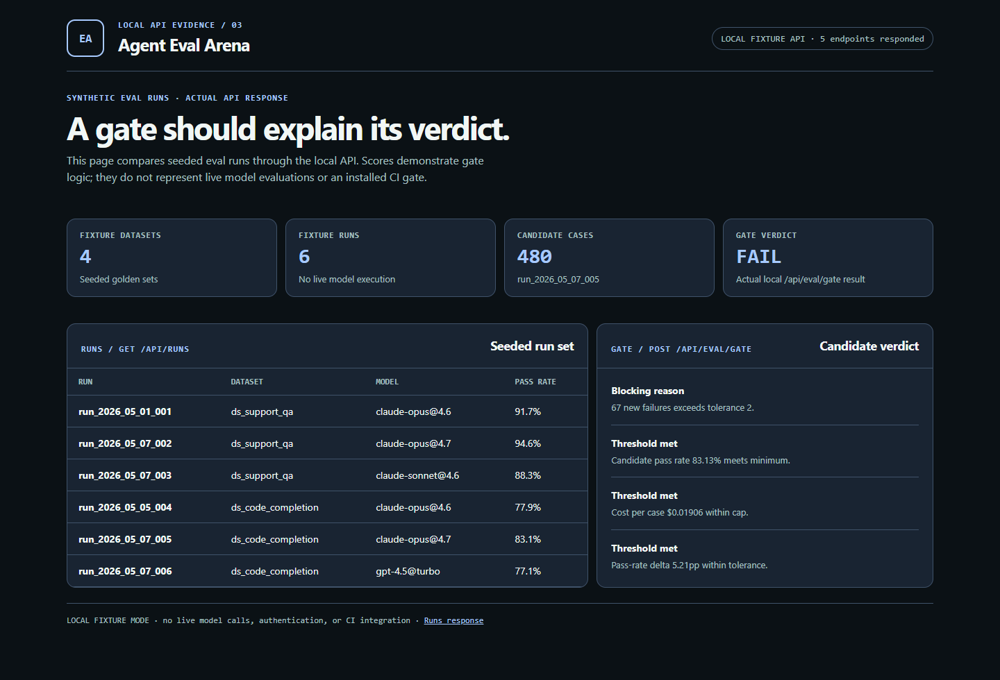

# Agent Eval Arena

[](https://github.com/mizcausevic-dev/agent-eval-arena/actions/workflows/ci.yml)

Local reference API for deterministic LLM evaluation. It scores caller-provided results, compares runs case by case, ranks seeded models, and returns a promotion gate verdict. The included datasets and runs are synthetic fixtures.

**Release boundary:** this is a local decision simulator, not a connected CI control. It does not execute models, persist new runs, verify dataset provenance, authenticate clients, or block a deployment. The demo binds to `127.0.0.1`; `NODE_ENV=production` rejects startup and imports of the app or route module. Do not submit real prompts or personal data.

## What it does

- Exact, fuzzy, token-overlap, and weighted rubric scoring.
- Regression comparison of baseline and candidate runs. Both runs must use the same dataset and the same unique case IDs.
- A gate that checks pass rate, new failures, and optional latency and cost limits. A `pass` is a calculation, not permission to promote a real model.
- Leaderboards over four fixture datasets and six fixture runs.

## API

| Method | Endpoint | Purpose |
| --- | --- | --- |
| GET | `/health` | Local process status |
| GET | `/api/datasets`, `/api/datasets/:id` | Read seeded datasets |
| GET | `/api/datasets/:id/runs`, `/api/datasets/:id/leaderboard` | Fixture runs and ranking |
| GET | `/api/runs`, `/api/runs/:id` | Read seeded run results |
| POST | `/api/score/exact-match`, `/api/score/fuzzy-match`, `/api/score/token-overlap`, `/api/score/rubric` | Score caller inputs |
| POST | `/api/eval/compare` | Compare matching case sets |
| POST | `/api/eval/gate` | Calculate a gate verdict |

The gate accepts `candidate`, optional `baseline`, and optional `thresholds`. Fetch a full run with `GET /api/runs/:id` to inspect the request structure. The two code-completion fixture runs, `run_2026_05_05_004` and `run_2026_05_07_005`, produce a **FAIL** gate under the demo thresholds: 67 new failures exceed a tolerance of 2. A higher aggregate pass rate does not cancel those newly failed cases.

## Screenshot



Captured from `http://127.0.0.1:3000/demo/runtime.html` against this repository's local server. The page fetches `/api/datasets`, `/api/runs`, and posts the fixture pair to `/api/eval/gate`. The source is `dashboard-preview/runtime.html` and `dashboard-preview/runtime.js`; the values are synthetic and no external provider was called.

## Run locally

Requires Node.js 20+ and npm.

```bash
git clone https://github.com/mizcausevic-dev/agent-eval-arena.git
cd agent-eval-arena
npm ci
npm run dev
```

Open `http://127.0.0.1:3000/demo/runtime.html` or `http://127.0.0.1:3000/api/datasets`.

```bash
npm test
npm run build
```

## Production gaps

Connect an actual model runner and immutable, versioned datasets; persist run evidence; authenticate and isolate clients; bound operational resource use; wire the gate into a reviewed CI workflow; and validate the policy against representative data before treating it as a release control. No production deployment is supplied.

MIT licensed. See [LICENSE](LICENSE).
